# Field Shift

**A voice and picture assistant, in Hindi and English, that helps rainfed farmers in Vidarbha compare ways to use their land through the year, built on NASA Earth data.**

Built for the NASA Space Apps Challenge 2026 (14–15 Nov), challenge [Adapting Farms with NASA Data](https://www.spaceappschallenge.org/2026/challenges/adapting-farms-with-nasa-data/). Team: Kartik and Amrita.

- **Try it:** https://field-shift-opal.vercel.app (open on an Android phone in Chrome, so voice works)
- **Engine API:** https://space-apps-dzma.onrender.com (`/health`, `/docs`). It sleeps when idle; the app wakes it when the page opens, so the first answer can take up to about a minute.

> **Field Shift supports, and does not replace, the judgement of farmers and local agricultural experts.** Every suggestion is a hypothesis for local review, and today every suggestion is labelled an *estimate*.

**Contents:** [1. The goal](#1-the-goal) · [2. Our approach](#2-our-approach) · [3. The app, screen by screen](#3-the-app-screen-by-screen) · [4. Future steps](#4-future-steps) · [Run it](#run-it) · [Data and credits](#data-and-credits) · [How it is built](#how-it-is-built) · [Honest status](#honest-status) · [Team and AI use](#team-and-ai-use)

---

## 1. The goal

### The challenge

NASA's Earth observation data is free and global, but a farmer deciding what to grow next season cannot use a satellite archive. The Space Apps challenge asks for tools that turn that data into decisions on the farm, as weather and seasons become less predictable.

### The problem we chose

We looked at **rainfed farms in Vidarbha, Maharashtra (Akola, Buldhana and Washim)**.

- **Fields sit empty for most of the year.** A common pattern is soybean in the monsoon season and then nothing. By the crop calendar in our crop sheet, a soybean-then-empty-field year leaves the field bare for about **268 days**. A soybean-then-sorghum year leaves it bare for about 148.
- **The climate is hard on crops.** In our data, April and May have 10 or more days a month above 38 °C, and August has long dry spells inside the monsoon (details in [Our approach](#what-the-data-shows-for-akola)).
- **The people who need the information can least use it.** Many farmers cannot read. A dashboard, a chart or a paragraph of advice does not reach them. The data itself is technical, regional and uncertain.

### What we set out to do

Give a farmer, in about the time of a short phone call, an honest comparison of the ways they could use one field through the year, and give a local expert the evidence behind each suggestion. Specifically:

1. **Compare real alternatives**, always including what the farmer does now.
2. **Say why**, with the evidence, the data source and the period behind every claim.
3. **Say what we do not know**: missing data, unchecked inputs, data that is coarser than a field.
4. **Reach people who cannot read**: speak the questions, speak the answers, and show everything as pictures.
5. **Stay in its place**: a starting point for a conversation with a farmer's own experience and a local agronomist, never a replacement for them.

---

## 2. Our approach

### How we want to solve it

| Idea | What it means in the app |
|---|---|
| **A phone call, not a dashboard** | One tap starts a conversation in Hindi or English. The app asks eight short questions aloud and the farmer answers by voice or by touching a picture. |
| **Pictures first, text second** | Every answer is a drawn picture. While an option is read aloud its picture lights up, so a picture and its word get linked. Results use no numbers and no scores. |
| **Compare, do not predict** | We do not claim to know next year's yield. We compare four ways of using the field against 45 years of weather and what the satellite sees. |
| **Evidence you can check** | Every evidence line names its dataset, its period and a validity flag. Experts can open them behind a "for experts" link. |
| **Honest about uncertainty** | Gaps and risks are always shown. When two datasets disagree we show both. Unchecked inputs make the whole suggestion an *estimate*, and the app says so. |

### The conversation

1. **Where is the farm?** If the phone gives a location, the app shows a satellite map with a red pin and asks "is this your farm?". If not, or the answer is no, it asks for the district. A phone outside our area is told so at once, skips the map and picks a district to see an *example*, clearly labelled as not the farmer's own farm.
2. **Seven more questions:** what is grown now, where the water comes from, the most important goal (and an optional second one), how much water is available, whether a sprayer or sowing machine is available, and where the crop is sold.
3. **Results the farmer can hear and see** (see [the screenshots](#3-the-app-screen-by-screen)).

### The engine: four ways to use one field

The engine (`engine/`, a transparent rule scorer, no machine learning) compares four options:

| | Option |
|---|---|
| S0 | **What the farmer does now** (soybean then an empty field, cotton, or soybean then chickpea) |
| S1 | Soybean, then chickpea |
| S2 | Cotton with pigeon pea grown between the rows |
| S3 | Soybean, then sorghum (cover crops such as sunn hemp and horse gram are scored as variants but not shown yet) |

Each option gets six part-scores from the evidence:

| Part | Asks | Evidence used |
|---|---|---|
| Water fit | Does the monsoon rain cover what the crop needs? | NASA POWER rain, crop water need |
| Timing fit | Does the crop fit between monsoon onset, the sowing window and the heat after March? | NASA POWER, crop sowing windows and durations |
| Bare days | How many days a year is the field empty? | Crop calendar, with MODIS greenness as site evidence |
| Nitrogen | Does it put nitrogen back (legumes)? | Crop sheet |
| Fodder | Does it feed animals? | Crop sheet |
| Market | What do the markets say? | Mandi prices and minimum support prices |

The **farmer's answers set the weights**. The first goal gets a fixed 40% of the total and the second 20%; the rest follows base weights. Low water availability raises the weight of water fit, and "for my own use" removes the market part. The weights used are returned with every result, and every tunable number lives in one file, [`engine/config.py`](engine/config.py).

Rules the engine follows, each covered by tests (156 in all):

- **No missing input is ever scored as zero**, and a data gap never flatters an option. An option scored on less than 70% of its intended weight is shown as incomplete and not ranked.
- **Ranges, not single numbers.** Scores are computed across years and shown as a band. Options within 5 points of the top are called a tie rather than ranked.
- **No option is shown without its gaps and risks.**
- **Where two datasets disagree, both are shown.**

### Honesty by design: checked advice and estimated advice

Every crop figure in our crop sheet is marked **valid** (we opened the source and read the number) or **unverified** (search summary, general knowledge or judgement). The app turns that into two plain labels:

- **जाँचा हुआ सुझाव** (checked advice): only when every input behind a suggestion is valid.
- **अनुमानित सुझाव** (estimated advice): everything else. **Today every suggestion carries this label**, because the crop inputs have not yet been checked in the field.

For example, pigeon pea's crop coefficients and season length were read from the measured PDKV Akola lysimeter study (valid), while its seasonal water need is our own derivation from those coefficients and NASA POWER weather (flagged unverified). See [`docs/crop_sheet.md`](docs/crop_sheet.md).

No language model writes any text. Every sentence the app speaks or shows is a template filled from engine fields, so no number is invented.

### What the data shows for Akola

| Finding | Source |
|---|---|
| Mean rain is about 877 mm a year, 740 mm of it June to September | NASA POWER 1981–2025 |
| Rain has risen over 1981–2025, and the length of dry spells and monsoon withdrawal agree | POWER and ERA5 agree |
| April and May are hot (10 or more days a month above 38 °C); March only in POWER | POWER and ERA5 |
| Long dry spells inside the monsoon in August (both datasets) and September (one) | POWER and ERA5 |
| No frost night at any of the three points | POWER and ERA5 |
| The temperature trend and the number of days above 40 °C in March to May **disagree** between datasets, so we show a range and claim no trend | POWER vs ERA5 |

How the hot and dry-spell months are decided (our own thresholds, shown to users): [`pipeline/season_risk.py`](pipeline/season_risk.py).

### Architecture

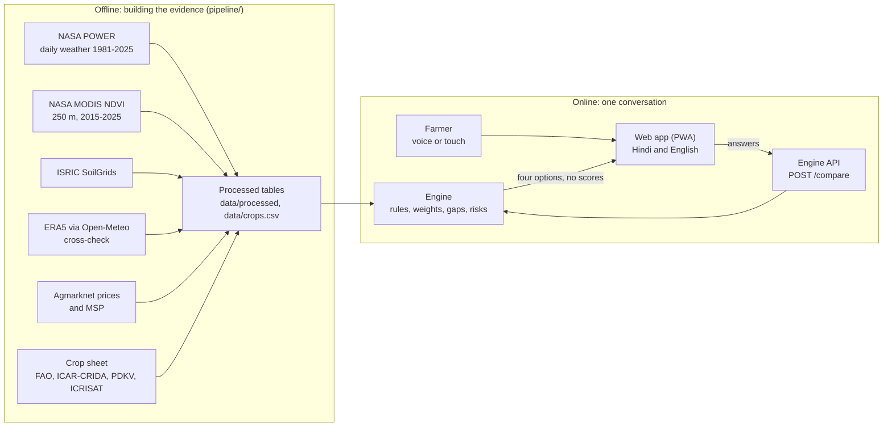

### What the Space Apps brief asked for, and where it is

| Brief item | Where it is |
|---|---|
| At least three strategies, including the current rotation | Four options; the current rotation is always one of them |
| Per strategy: why, evidence, benefits, gaps, risks | Spoken rows plus a "for experts" evidence list |
| Bare-field windows and a timeline | The 12-month year bar (June to May) with a month axis |
| Vulnerable seasons | Hot and dry-spell months under the year bar, and a spoken "sensitive times" row |
| Farmer priorities and constraints as inputs | The eight questions |
| Explainers (evapotranspiration, soil-moisture anomaly, NDVI, frost, water balance) | The "Explained" screen, each one spoken |
| Satellite versus ground data | The last item on "Explained" |
| Uncertainty and where local validation is needed | The estimate label, the "what is not checked" row and "ask an expert" |
| A map of the farm location | A satellite map with a pin that the farmer confirms |
| Scenario slider | Not built |

---

## 3. The app, screen by screen

These are real screens of the running app at phone size, in the order a farmer meets them. (Speech is simulated while taking the pictures, because a headless browser has no voice. The satellite map screen is not shown, because it is Google's map imagery.)

### Start

One tap starts the call, or the form can be used instead. A switch at the top changes the whole app between Hindi and English: the call, the form, the results and the "supports, does not replace" bar at the bottom of every screen. The form asks the same questions as the call, in the chosen language, and opens the same results.

<table>
<tr>
<td align="center">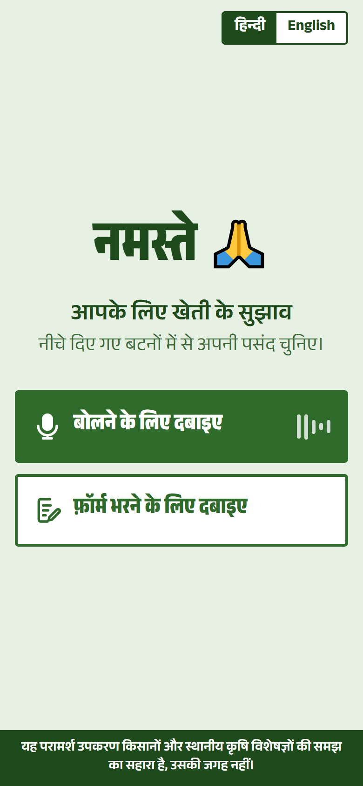<br><sub>1. Start (Hindi)</sub></td>
<td align="center">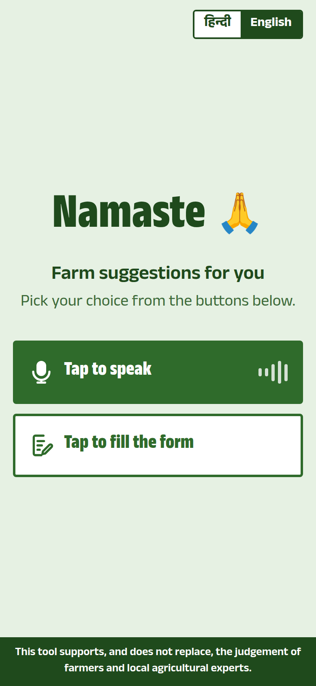<br><sub>2. The same screen in English</sub></td>
</tr>
</table>

### Where is the farm?

With a location, the call shows a satellite map and asks the farmer to confirm the pin. Without one it asks the district (left). A phone outside Akola, Buldhana and Washim is told so, skips the map and asks for a district to show an *example* (right).

<table>
<tr>
<td align="center">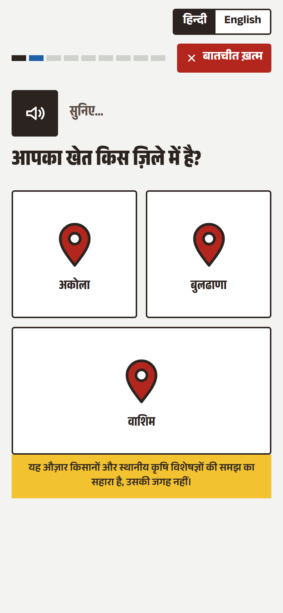<br><sub>3. District question</sub></td>
<td align="center">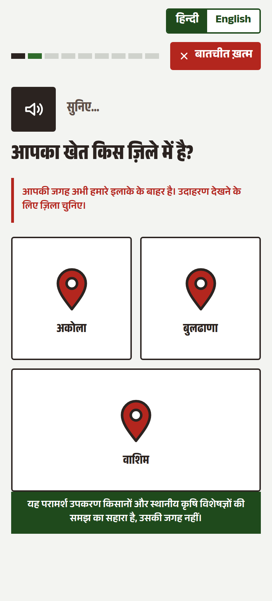<br><sub>4. A phone outside our area</sub></td>
</tr>
</table>

### The questions

Each question is read aloud; each option's picture lights up as it is read; the farmer answers by speaking or by touching a picture. The bar at the top shows progress without numbers.

<table>
<tr>
<td align="center">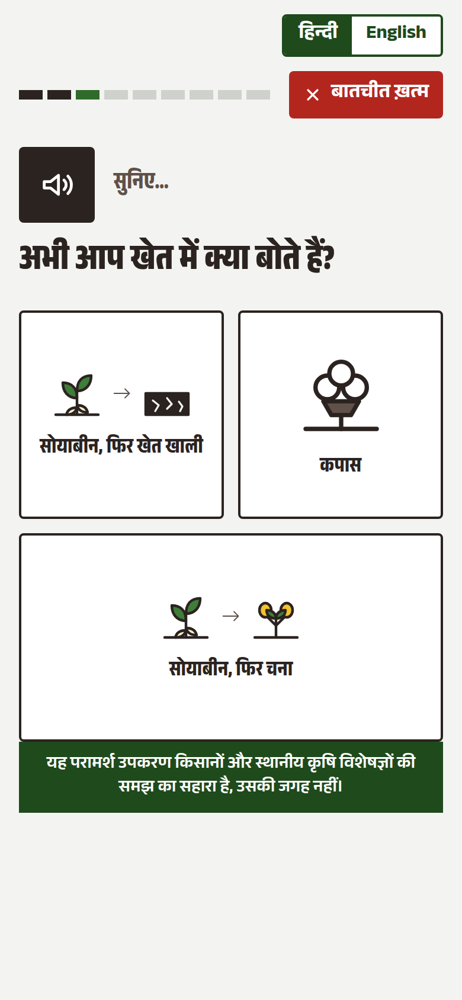<br><sub>5. What is grown now</sub></td>
<td align="center">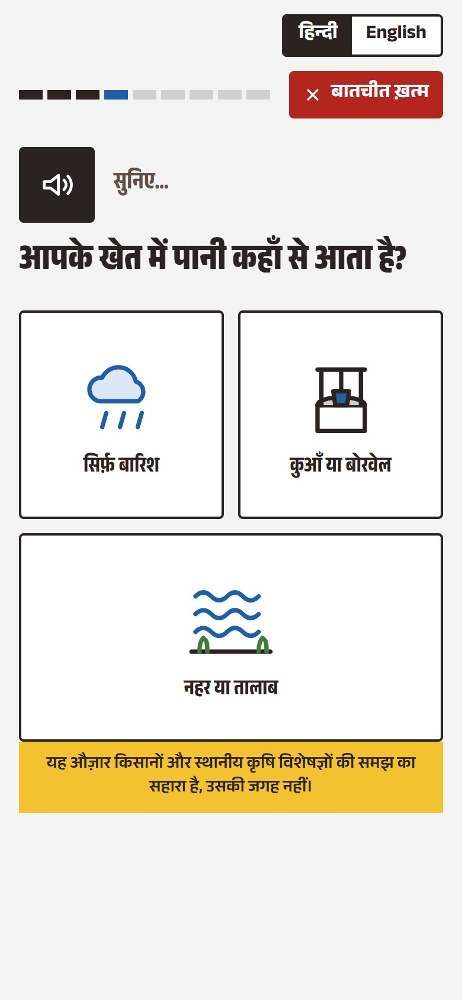<br><sub>6. Where the water comes from</sub></td>
<td align="center">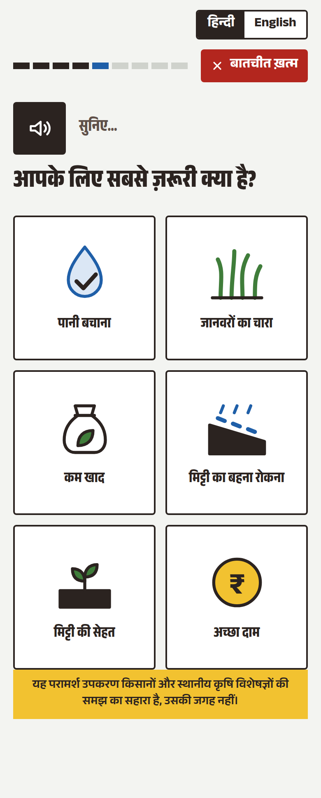<br><sub>7. What matters most</sub></td>
<td align="center">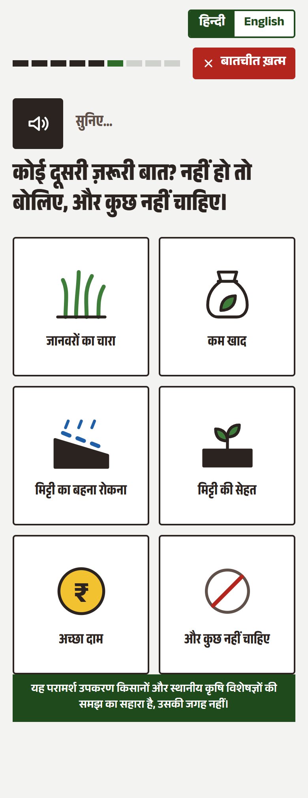<br><sub>8. A second goal, or none</sub></td>
</tr>
<tr>
<td align="center">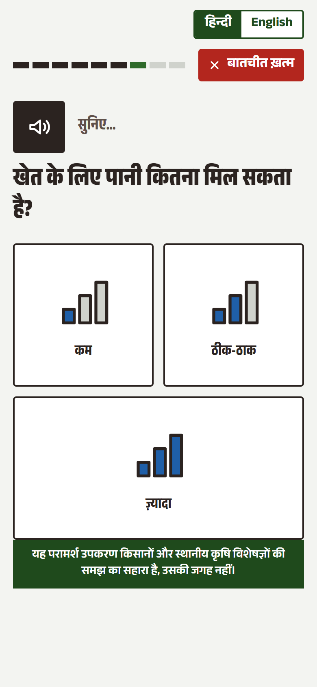<br><sub>9. How much water is available</sub></td>
<td align="center">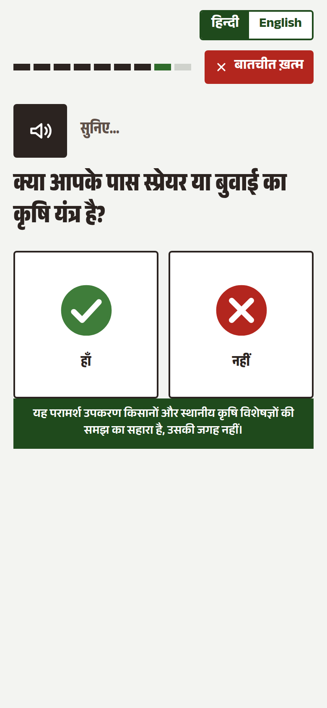<br><sub>10. Sprayer or sowing machine</sub></td>
<td align="center">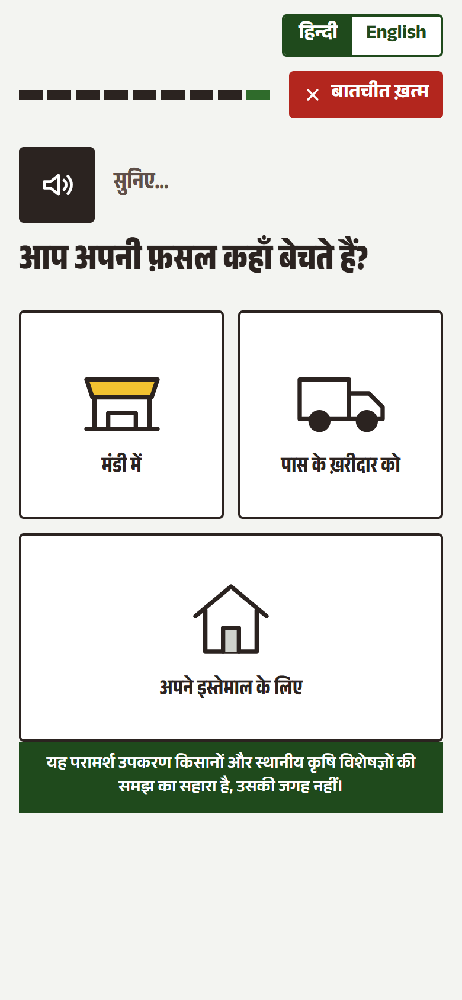<br><sub>11. Where the crop is sold</sub></td>
<td></td>
</tr>
</table>

### The results

The four options come back best first, with a thumbs-up on the top choice (or choices, when they are a tie) and **no scores**. Each shows its 12-month year bar: green is a crop in the ground, dark is a bare field, with kharif and rabi grouped. A dashed badge says the advice is an estimate. The line at the top says which place the weather and satellite data stand in for.

<table>
<tr>
<td align="center">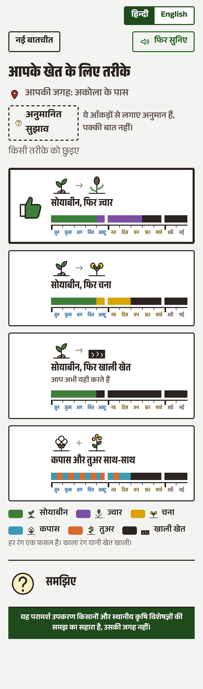<br><sub>12. The four options</sub></td>
<td align="center">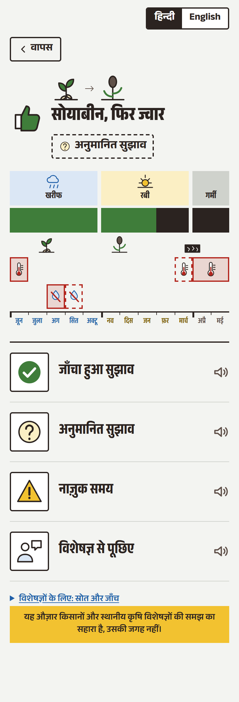<br><sub>13. One option: year bar, hot months and dry spells, four spoken rows</sub></td>
</tr>
</table>

### Inside one option

Under the year bar, thermometer marks show the hot months and crossed-out drops show the long dry spells; a solid mark means both datasets agree, a dashed one that only one does. Four rows speak when tapped.

<table>
<tr>
<td align="center">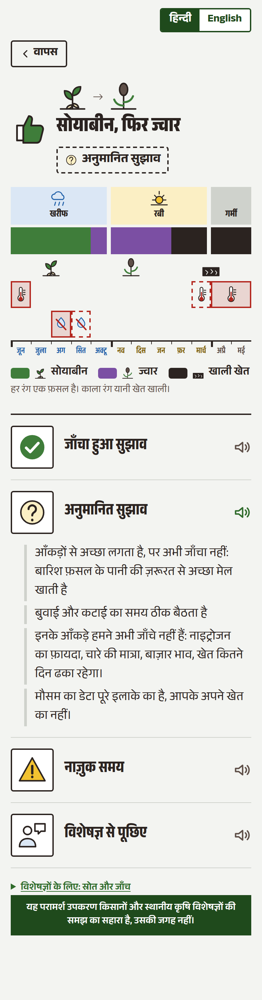<br><sub>14. Estimated advice: what looks good but is not checked, and what is not checked</sub></td>
<td align="center">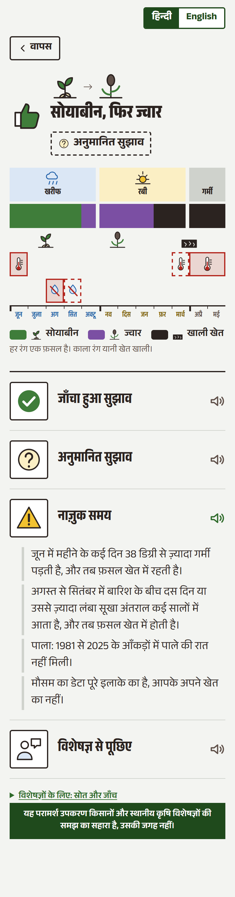<br><sub>15. Sensitive times: when the crop is in the ground during hot or dry months</sub></td>
<td align="center">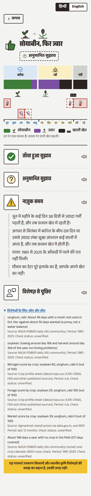<br><sub>16. For experts: every evidence line with its source, period and validity flag</sub></td>
</tr>
</table>

### Understanding the words

The "Explained" screen explains the terms in plain language, each one spoken: evapotranspiration, soil-moisture anomaly, greenness (NDVI), frost, water balance, and satellite versus ground data.

<table>
<tr>
<td align="center">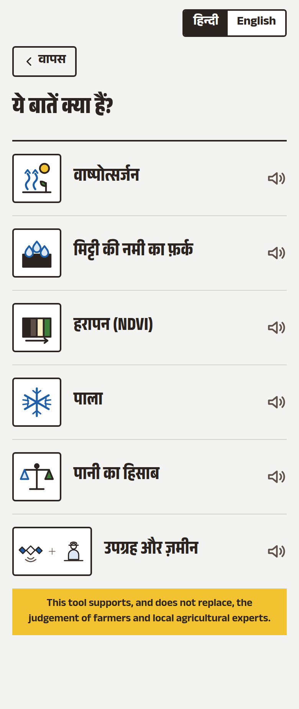<br><sub>17. Explained (Hindi)</sub></td>
<td align="center">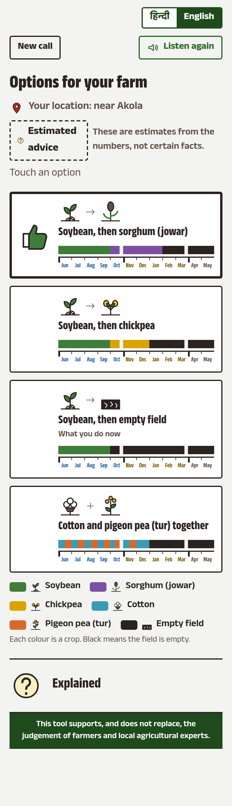<br><sub>18. Results in English</sub></td>
<td align="center">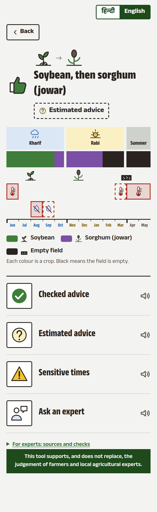<br><sub>19. One option in English</sub></td>
</tr>
</table>

### An example for a farmer outside our area

If a phone is outside the three districts, the results are labelled "Example (not your farm)" so nobody mistakes them for advice about their own field.

<table>
<tr>
<td align="center">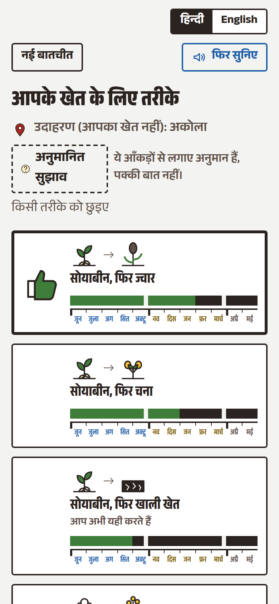<br><sub>20. Example results for a district</sub></td>
</tr>
</table>

The pictures were made with [`scripts/readme_screenshots.py`](scripts/readme_screenshots.py), which you can run against your own copy of the app.

---

## 4. Future steps

What is built today is a working prototype for one region. This is where we want to take it. Each item says what is already in place and what is still missing.

### A. A fully conversational, phone-like assistant

**Today:** the app asks a fixed list of questions. It reads a question and its options, then listens. While it is reading you cannot interrupt by voice (you can tap a picture). Speech uses the browser's built-in Hindi and English voices, which work best in Chrome on Android.

**Where we want to go:** a conversation that feels like calling a knowledgeable neighbour.

- **Interrupt and answer naturally**: talk over the question, say a whole sentence ("I grow soybean and I have a borewell") and have several answers picked up at once.
- **Follow-up and clarification**: ask back when an answer is unclear ("did you mean the well or the canal?"), and let the farmer ask "why?" about any suggestion.
- **Better speech for rural India**: speech recognition and voice built for Indian languages and accents (we have chosen Sarvam for this; it needs an account and key and is not integrated yet), then Marathi, the region's own language, reviewed by native speakers.
- **Reach feature phones**: the same conversation by a phone call or voice message, so a smartphone is not required.
- **A model that talks, but cannot invent**: a language model may phrase the conversation, but only from engine output, with every number checked against it. That rule is already how the app works today, using templates.
- **Remember the farmer** (with consent): their fields and last answers, so a second call starts where the first ended.

### B. From three districts to all of India

**Today:** the engine serves a point only inside our soil data tile and within 50 km of one of three farm points. That rule is data-driven: a registry of covered tiles and points, so adding an area means adding data and an entry, not rewriting code.

**Where we want to go:**

- **Weather for any point**: fetch NASA POWER for the farmer's own location instead of three presets, and drop the 50 km limit.
- **Satellite for any area**: MODIS greenness as a region-wide raster instead of three points.
- **Soil everywhere**: SoilGrids is global, so soil tiles can follow the same pattern.
- **Prices nationwide**: the Agmarknet mandi price data already covers markets across India.
- **Local crop calendars**: ICAR-CRIDA publishes district contingency plans for many districts across states; we used Akola's for sowing windows. Each new region needs its own calendar and a local check.
- **Local validation**: each new region gets a check by its own Krishi Vigyan Kendra or agricultural university before its suggestions are called "checked".
- **More languages**: Marathi first, then the languages of the regions we add.

### C. More crops, as more data arrives

**Today:** the crop sheet has one row per crop (nine rows, including an empty-field baseline, feeding four options in the engine), and each value carries a validity flag. We have just done this for pigeon pea: a missing figure was replaced by measured values from a PDKV Akola study, and the option moved from "not ranked" to ranked.

**Where we want to go:**

- **Generate options instead of listing four**: build candidate rotations and intercrops from the crop sheet and the local sowing windows, then filter by what fits the farmer's water and equipment.
- **Grow the crop sheet with sources**: each new crop is a row with its sources and its flags, so a crop with weak data is shown as an estimate, never hidden.
- **Cover crops and varieties**: show the cover-crop options the engine already scores (sunn hemp, horse gram), and add varieties with their own durations.
- **Crop figures by agro-climatic zone**, not one table for everywhere.

### D. Horticulture, not just field crops

Orchards, vegetables and flowers need a different model from a one-season field crop, so this is a research step before it is a build step.

- **Perennials and orchards**: trees live for years, so the model has to look across years: planting cost, years to first harvest, water in the driest months, and sensitivity at flowering to heat and frost.
- **Vegetables and short-cycle crops**: fit them into the year bar alongside field crops, with their own sowing windows and water.
- **Perishable markets**: prices that swing within a month, storage, and distance to market matter more than for grain.
- **Data to find**: crop coefficients and water need for orchard and vegetable crops (FAO-56 covers many), state horticulture department statistics, and local advice. As now, every figure would carry a validity flag.

### E. Making the advice trustworthy enough to act on

- **Check the inputs in the field** with farmers and local experts, so that suggestions can earn the "checked advice" label. The app already switches the label by itself when every input is valid.
- **Read the Hindi and English with native speakers**, and replace the drawn placeholder crop pictures with real drawings or photos.
- **Use the water source** the farmer gives (the engine collects it but does not use it yet).
- **Scenario slider** ("what if the monsoon is late?"), and **SMAP soil moisture** for the soil-moisture explainer.
- **Higher-resolution data** where it exists, so advice moves from the area towards the field.

---

## Run it

You need Python 3.11 or newer (we use 3.14) and Node.js 20 or newer.

```bash
# engine API (from the repo root)
python3 -m venv .venv && .venv/bin/pip install -r requirements-dev.txt   # requirements.txt alone is enough to run the API
.venv/bin/python -m pytest                                   # 156 tests
.venv/bin/uvicorn api.main:app --port 8000                   # docs at http://127.0.0.1:8000/docs

# web app (second terminal)
cd web && npm install && npm run dev                         # http://localhost:3000
```

On Windows use `.venv\Scripts\python` in place of `.venv/bin/python`. Details for the web app: [web/README.md](web/README.md).

Try the API without the app:

```bash
curl -s localhost:8000/compare -H 'content-type: application/json' \
  -d '{"location":"akola","priorities":["water_saving"],"constraints":{"water_availability":"low"}}'
```

### Settings

| Variable | Where | What it does |
|---|---|---|
| `NEXT_PUBLIC_API_URL` | web | Address of the engine API. Default `http://127.0.0.1:8000`. Read at build time. |
| `ALLOWED_ORIGINS` | API | Comma-separated web addresses allowed to call the API. Default is open, fine for a demo only. |
| `ADMIN_TOKEN` | API | Turns on `GET /admin/stats` (send it as the `x-admin-token` header). Unset means the route is off. |
| `USAGE_LOG` | API | Where the anonymous usage log goes. Default `data/usage.jsonl`. |

The usage log has one line per `/compare` call: time, district, rotation, water source, priorities, whether it was served, and latency. It stores no coordinates and no identity.

To try the app on a phone on the same Wi-Fi, run the API with `--host 0.0.0.0`, start the web app with `NEXT_PUBLIC_API_URL` set to your computer's address, and open that address on the phone. The microphone and the phone's location only work on HTTPS (or localhost), so voice answers need a deployed or tunnelled build. Tapping works on plain HTTP.

---

## Data and credits

**NASA data**

| Data | Used for |
|---|---|
| NASA POWER, daily 1981–2025 (temperature, rain, soil wetness, humidity, solar radiation) | Rain and water fit, monsoon onset and withdrawal, dry spells, heat days |
| MODIS MOD13Q1.061 NDVI (250 m, 16-day, 2015–2025) via NASA AppEEARS | Bare-field windows and crop seasons seen from space |

NASA SMAP soil moisture was searched in the catalogue but is not used.

**Non-NASA data**

| Data | Used for |
|---|---|
| ISRIC SoilGrids (clay, sand, pH, soil carbon) | Soil context |
| ERA5 reanalysis (Copernicus/ECMWF) through Open-Meteo, CC BY 4.0 | Independent cross-check of POWER |
| Agmarknet mandi prices via data.gov.in, and announced minimum support prices | Market score |
| Crop parameters: FAO-56, FAO Irrigation Water Management Training Manual 3, ICAR-CRIDA Akola contingency plan, PDKV Akola lysimeter study (MahaPOCRA), ICRISAT, FAO ECOCROP | Crop sheet (`data/crops.csv`); each value is marked valid or unverified |
| Google's keyless map embed | The satellite map on the farm-confirmation question |

Every number in the crop sheet is marked **valid** or **unverified**. See [docs/crop_sheet.md](docs/crop_sheet.md) and [docs/crop_gap_research.md](docs/crop_gap_research.md).

### How the vulnerable months are decided

`pipeline/season_risk.py` reads the daily POWER and ERA5 files and writes `data/processed/season_risk.json`, which the engine returns with `/compare`. The thresholds are our own and are shown to users:

- **Hot month:** on average at least 10 days a month above 38 °C (1981–2025).
- **Dry-spell month:** in at least 4 years in 10, a dry run of 10 or more days (under 2.5 mm of rain a day) inside that year's monsoon, from onset to withdrawal, overlaps the month.
- **Frost night:** a minimum temperature of 2 °C or below.
- A month is marked **solid** when both datasets reach the threshold and **dashed** when only one does.

The "sensitive times" row says when a choice's crop is in the ground during those months. It does not know each crop's most sensitive stage in days (the crop sheet only has it as text and mostly unverified), so it does not claim to.

---

## How it is built

```
data/        raw pulls (gitignored) and processed tables
pipeline/    fetch and feature derivation (Python)
engine/      transparent rule scorer; every tunable number is in engine/config.py
api/         POST /compare, GET /health, GET /admin/stats
web/         Next.js PWA: voice call, picture questions, results, Hindi and English
voice/       reserved for the Sarvam speech integration (empty for now)
scripts/     screenshots and deployment helpers
docs/        design, crop sheet, data quality, plans, demo script, submission text
tests/       156 tests, written first
```

- Engine design and the rules behind every score: [docs/ENGINE_DESIGN.md](docs/ENGINE_DESIGN.md)
- Voice app plan and who it is for: [docs/VOICE_APP_PLAN.md](docs/VOICE_APP_PLAN.md)
- Colours, type and layout: [web/DESIGN.md](web/DESIGN.md)
- Open decisions and engine review: [docs/discussions.md](docs/discussions.md)
- Project page text and the 2-minute demo script: [docs/SUBMISSION.md](docs/SUBMISSION.md), [docs/DEMO_SCRIPT.md](docs/DEMO_SCRIPT.md)

---

## Honest status

What works, and what does not yet.

**Works today:** the voice-and-touch call in Hindi and English; the form, in either language, leading to the same results; the four-option engine over three districts; the year bars with bare windows and sensitive months; the checked and estimated labels; the explainers; the out-of-area example flow; live deployment; 156 passing tests.

**Not done, or not good enough yet:**

- **Every suggestion is an estimate.** The crop sheet's inputs are mostly unverified, which is why no suggestion can yet earn the "checked" label.
- **Speech is the browser's built-in Hindi and English**, not Sarvam. It works best in Chrome or Edge on Android, cannot be interrupted by voice, and Sarvam is planned and needs an account and key.
- **The map is Google's keyless embed**, which is not an official, supported product, and the browser sends the farm's coordinates (rounded to about 100 m) to Google when it loads. Phone location needs HTTPS. Without a map the app still works from the district tiles.
- **Deployment is free-tier.** The app is on Vercel and the engine API on Render; the API sleeps when idle. They redeploy after a push only while the watcher script runs on Amrita's PC (see `web/README.md`).
- **All Hindi and English text is machine-drafted** and has not been reviewed by a native speaker. Marathi, the real language of the region, waits for a native reviewer.
- **Crop pictures are drawn placeholders.** Real drawings or photos are needed.
- **The engine ignores the water source** the farmer gives (see the engine review in docs/discussions.md).
- **Scenario slider** is not built.
- **Sunn hemp and horse gram are scored but not shown.** The engine scores them as alternatives to sorghum after soybean, but their data is too thin to show as options: the sowing windows are unverified (horse gram is even sown before the soybean is harvested), there are no mandi prices, and the engine does not yet apply its data-coverage rule to these alternatives. The app says so on its explainers screen ("दूसरी फ़सलें" / "Other crops"). The crops a farmer can name as their current rotation are limited to three (soybean then empty field, cotton, soybean then chickpea).
- **Cover-crop variants** (sunn hemp, horse gram) are scored but not shown.

**Limits to keep in mind:** weather is area-scale (about 25–50 km), satellite pixels are 250 m and mixed, rain is reanalysis and not gauge data, the water proxy for rabi crops is rough, and all penalties in the scoring are our own assumptions, written down in `engine/config.py`. Treat the output as a conversation starter for a local expert.

---

## Team and AI use

Team: **Kartik** and **Amrita**, working jointly on everything. Our working agreement is in [CLAUDE.md](CLAUDE.md).

We each worked with Claude Code (Anthropic) as a coding assistant. It helped write the data pipeline, the engine, the tests, the web app, the documentation and the first drafts of the Hindi and English text; we directed the work and reviewed it. **No AI model runs inside the product**: results come from rules over data, and every sentence is a template. The Hindi and English text has not been checked by a native speaker.

Data credits are in [Data and credits](#data-and-credits). NASA POWER and MODIS data are courtesy of NASA; ERA5 contains modified Copernicus Climate Change Service information.
